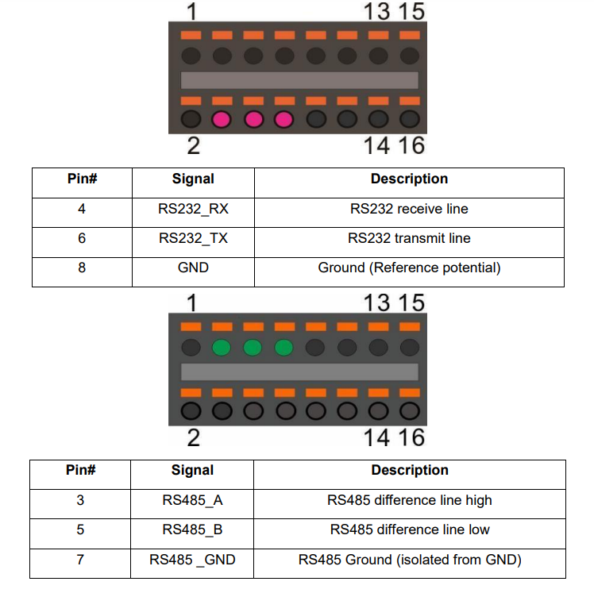

# KWF Energiemonitor Node-RED auf Balena

## Info
Dieses Repository beinhaltet das Template für Node-RED auf der Balena-Umgebung. Dieser Teil läuft auf der Energiemonitor-Hardware, fragt alle benötigten Daten ab und schickt sie an ein Dashboard sowie an eine Datenbank

## Einrichten auf Node-RED
Node-RED Container über Balena deployen und im Node-RED History-Tab dieses Repository clonen. Verschiedene Konfigurationen (verschiedene KWF Wohneinheiten) können über Branches gehandhabt werden. Main soll ein Template sein mit einer Übersicht aller Konnektoren.

## Status
__Implementiert__
- Shelly Pro 3EM Stromverbrauch 230V auf 3 Phasen
- Netatmo Wetterstation innen und aussen
- OAUTH2-Flow für die Authentifizierung bei Netatmo
- Daten senden an Thingsboard
- Daten senden an Azure Table Storage (Datenbank)
- PZEM-017 für DC-Messung
- Neustart bei Netzwerkproblemen

__Nicht implementiert__
- Dashboard direkt auf Node-RED

__Entfernt__
- Support für Sensoren mit Tuya. Schlechte Erfahrungen mit Qualität und Antennenleistung
- Offizieller Netatmo-Block wird nicht mehr maintained. Im Tab "Netatmo Authentication" ist jetzt ein manueller Flow für OAUTH2.

# Konfiguration des Energiemonitors
Zum Bau eines neuen Energiemonitors müssen gewisse Keys vorhanden sein. Wir handhaben dies als Environment-Variablen über die gesamte Balena-Flotte und versuchen, möglichst die gleichen Keys für die ganze Flotte zu verwenden. Variablen, die nur für ein Gerät gültig sind (z.B. Shelly IP-Adresse) können als Device-Variable konfiguriert werden.

### Konfig-Files
Damit der Energiemonitor ein WLAN-Netzwerk erstellt, muss das WLAN Konfig-File im /system-connections/ Folder (Balena OS) erstellt werden [wie in der Balena Doku beschrieben](https://docs.balena.io/reference/OS/network/). Das gleiche fürs Setup des LTE-Moduls. Die Beispiel-Files [befinden sich im Config-Ordner auf diesem Repo.](./config)

## Shelly Pro 3EM für Stromverbrauch 230V
Dieser Shelly verbindet sich übers WLAN-Netzerk des Energiemonitors. Damit Node-RED mit ihm kommunizieren kann, muss die konfigurierte IP-Adresse in den Device-Variablen konfiguriert werden. Messwerte werden dann über den offiziellen Shelly-Block jede Sekunde abgefragt und über 10 Sekunden aggregiert.

## Netatmo-Wetterstation
Die Wetterstation verbindet sich übers Energiemonitor-Wifi mit dem Internet und lädt die Daten auf die Netatmo-Cloud hoch. Im Energiemonitor tun wir so, als würden die Daten direkt vom Energiemonitor kommen und fragen sie im Node-RED alle 3 Minuten von der Netatmo-Cloud ab. Leider wird der offizielle Netatmo-Block, auf dem ich die erste Version aufgebaut hatte, nicht mehr maintained. Ich arbeite jetzt mit dem OAUTH2-Block und mache der Einfachheit halber vor jeder Abfrage ein Token-Refresh.

### Konfiguration bei einem neuen Energiemonitor:
Auf [dem Netatmo Developer-Portal](https://dev.netatmo.com) mit dem Token-Generator ein initiales Token erstellen und im OAUTH2-Block eintragen (nur das Refresh-Token). Dieses ändert sich dann bei jeder Abfrage, deshalb kann das einfach so im Node-RED eingetragen werden. Client-ID und Client-Secret werden über Environment-Variablen gehandhabt. Todo: Sollte man für jeden Energiemonitor eine separate App erstellen, damit die Token nicht durcheinandergeraten, wenn verschiedene Monitoren zu verschiedenen Zeiten ein Token-Refresh machen?

### Todo beim Bau des nächsten Energiemonitors:
Jede Wetterstation hat eine eigene MAC-Adresse. Diese als Device-Variabel speichern und die Abfrage bei Netatmo so ändern, dass nur Daten der "eigenen" Wetterstation weitergegeben werden.

### Refresh-Token und Access-Token nicht verlieren beim Neustart
Im Moment werden die aktuellen Token in ein File auf dem persistenten Speicher (/data) geschrieben und beim Neustart von dort gelesen.

## DC-Messung mit Shunt und Peacefair Gerät

### Gerät einrichten
Ich kann dieses [Python-Projekt](https://github.com/croutonso/PZEM017modbus/tree/main) empfehlen, damit kann das Peacefair zur Einrichtung über den USB-Port am PC getestet und konfiguriert werden, und alle möglichen Modbus-Adressen nachgeschaut werden.

Wichtig bei diesem Schritt: 
- Adresse auf Default (0x01) einstellen
- Current Range anpassen, je nachdem welcher Shunt installiert ist.

#### Verkabelung mit GPIO
Danach das Peacefair verkabeln: Pin A -> 3, B -> 5 und GND -> 7 nach folgendem Schema (für RS485):

- Funktioniert so nicht. Wird ein TTL-Converter benötigt?

#### Verkabelung über RS485-USB Converter
Das Peacefair mit dem RS485-to-USB Converter verkabeln und am USB-Port verbinden. Testen, ob Daten abgefragt werden, sonst im Node-RED Block den USB-Port für Modbus konfigurieren (Standard: dev/ttyUSB0)

Todo: Verkabelung mit Batterie und Shunt (siehe Bild hinten auf dem PZEM). Test, ob 5V wirklich angeschlossen werden muss, oder ob das Modul durch die 12V-Leitung genügend versorgt ist.

Für das Auslesen über Modbus verwende ich die [Bitpool-Library](https://wiki.bitpool.com/bitpool-edge/connectors/bitpool-edge-modbus), da diese etwas einfacher ist und mit weniger Blocks auskommt.

# Frühere Versionen
Die frühere Version der FH OST befindet sich auf dem Branch "BA_OST"
Die Version mit Tuya Sensoren befindet sich auf dem Branch "tuya_deprecated"