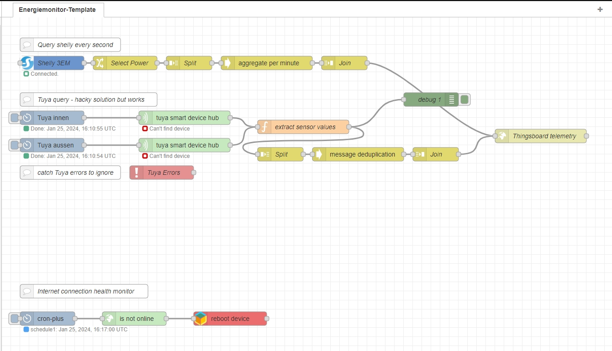
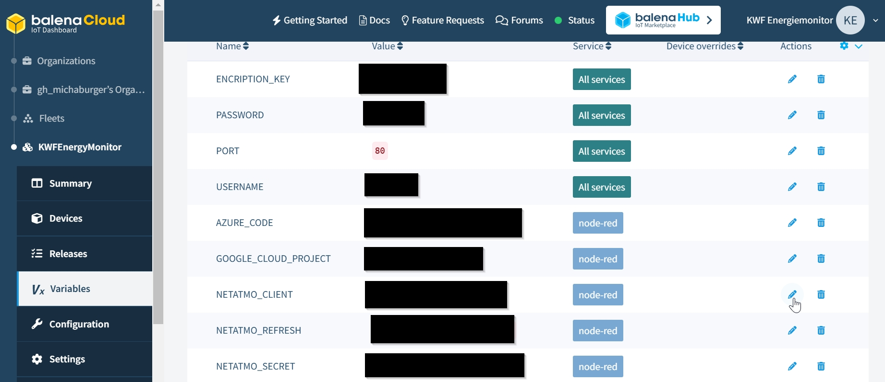

# KWF Energiemonitor Node-RED auf Balena

## Info
Dieses Repository beinhaltet das Template für Node-RED auf der Balena-Umgebung. Dieser Teil läuft auf der Energiemonitor-Hardware, fragt alle benötigten Daten ab und schickt sie an ein Dashboard sowie an eine Datenbank

## Einrichten auf Node-RED
Node-RED Container über Balena deployen und im Node-RED History-Tab dieses Repository clonen. Verschiedene Konfigurationen (verschiedene KWF Wohneinheiten) können über Branches gehandhabt werden. Main soll ein Template sein mit einer Übersicht aller Konnektoren.

## Status
__Implementiert__
- Shelly Pro 3EM Stromverbrauch 230V auf 3 Phasen
- Netatmo Wetterstation innen und aussen
- Daten senden an Thingsboard
- Daten senden an Azure Table Storage (Datenbank)
- Neustart bei Netzwerkproblemen

__Nicht implementiert__
- 12V Monitor über RS485 (Peacefair)

__Entfernt__
- Support für Sensoren mit Tuya. Schlechte Erfahrungen mit Qualität und Antennenleistung

# Konfiguration des Energiemonitors
Zum Bau eines neuen Energiemonitors müssen auch gewisse Keys vorhanden sein. Wir handhaben dies als Environment-Variablen über die gesamte Balena-Flotte und versuchen, möglichst die gleichen Keys für die ganze Flotte zu verwenden. Variablen, die nur für ein Gerät gültig sind (z.B. Shelly IP-Adresse) können als Device-Variable konfiguriert werden.

### Konfig-Files
Damit der Energiemonitor ein WLAN-Netzwerk erstellt, muss das WLAN Konfig-File im /system-connections/ Folder (Balena OS) erstellt werden [wie in der Balena Doku beschrieben](https://docs.balena.io/reference/OS/network/). Das gleiche fürs Setup des LTE-Moduls. Die Beispiel-Files [befinden sich im Config-Ordner auf diesem Repo.](./config)

## Shelly Pro 3EM für Stromverbrauch 230V
Dieser Shelly verbindet sich übers WLAN-Netzerk des Energiemonitors. Damit Node-RED mit ihm kommunizieren kann, muss die konfigurierte IP-Adresse in den Device-Variablen konfiguriert werden. Messwerte werden dann über den offiziellen Shelly-Block jede Sekunde abgefragt und über 10 Sekunden aggregiert.

## Netatmo-Wetterstation
Die Wetterstation verbindet sich übers Energiemonitor-Wifi mit dem Internet und lädt die Daten auf die Netatmo-Cloud hoch. Im Energiemonitor tun wir so, als würden die Daten direkt vom Energiemonitor kommen und fragen sie im Node-RED alle 3 Minuten von der Netatmo-Cloud ab. Leider wird der offizielle Netatmo-Block, auf dem ich die erste Version aufgebaut hatte, nicht mehr maintained. Ich arbeite jetzt mit dem OAUTH2-Block und mache der Einfachheit halber vor jeder Abfrage ein Token-Refresh.

### Konfiguration bei einem neuen Energiemonitor:
Auf [dem Netatmo Developer-Portal](https://dev.netatmo.com) mit dem Token-Generator ein initiales Token erstellen und im OAUTH2-Block eintragen (nur das Refresh-Token). Dieses ändert sich dann bei jeder Abfrage, deshalb kann das einfach so im Node-RED eingetragen werden. Client-ID und Client-Secret werden über Environment-Variablen gehandhabt. Todo: Sollte man für jeden Energiemonitor eine separate App erstellen, damit die Token nicht durcheinandergeraten, wenn verschiedene Monitoren zu verschiedenen Zeiten ein Token-Refresh machen?

### Todo beim Bau des nächsten Energiemonitors:
Jede Wetterstation hat eine eigene MAC-Adresse. Diese als Device-Variabel speichern und die Abfrage bei Netatmo so ändern, dass nur Daten der "eigenen" Wetterstation weitergegeben werden (in der Datenbank speichern wir bereits die MAC-Adresse der Wetterstation, aber es braucht ja nicht jeder Energiemonitor die Daten aller Monitore weiterzuleiten)

## DC-Messung mit Shunt und Peacefair Gerät
Todo

# Frühere Versionen
Die frühere Version der FH OST befindet sich auf dem Branch "BA_OST"
Die Version mit Tuya Sensoren befindet sich auf dem Branch "tuya_deprecated"